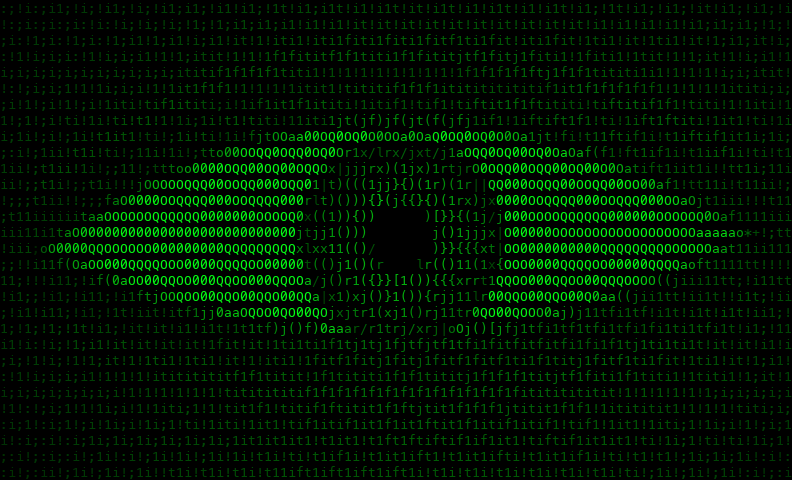
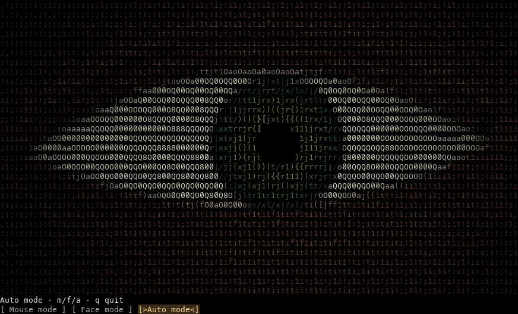

# Terminal Eye 0.5 · macOS Terminal / iTerm2

Живой человеческий глаз из цветных символов: тёплая кожа, складки век, светлая склера, зелёно-янтарная радужка и чёрный зрачок. Существующий прототип доработан по всем кадрам из `assets/reference`. Это процедурная интерпретация референса: форма, освещение и плотность символов приближены к ролику, но покадровое совпадение не заявляется.



Превью вывода команды `terminal-eye preview --theme hacker --width 120 --height 36`. Изображение отрисовано из фактических ANSI-символов и цветов приложения; это не снимок окна Terminal.app.



Подготовленный проект находится в `/Users/muratovaslan/StudioProjects/TerminalEye`. Все команды для этой установки и пояснения собраны в **[ОСЫНЫ АШ.md](<ОСЫНЫ АШ.md>)**. Окружение `.venv` пересоздано по новому пути.

## Сетка окон и цвета

Из папки проекта эта команда открывает девять отдельных окон с яркими зелёными глазами. Каждый смотрит на один курсор со своей стороны; камера выключена:

```bash
.venv/bin/terminal-eye wall --count 9 --columns 3 --theme hacker
```

`--count` задаёт количество 1..36, `--columns` — число колонок; если окна не помещаются, команда предлагает уменьшить сетку. Учитываются Dock/меню. Есть `--gap`, `--margin`, `--screen 2`, `--app iterm`, `--fps 12`, `--style blocks`, `--mode idle`. `--dry-run` печатает расчёт без открытия окон. Каждый запуск создаёт новую сетку; обычные окна не перестраиваются. На первом запуске macOS может запросить разрешение Automation.

```bash
.venv/bin/terminal-eye wall --count 4 --columns 2 --theme blue
.venv/bin/terminal-eye wall --count 6 --columns 3 --theme noir
.venv/bin/terminal-eye wall --count 9 --theme matrix
.venv/bin/terminal-eye wall --count 9 --theme mixed
.venv/bin/terminal-eye themes
.venv/bin/terminal-eye watch --mode mouse --theme hacker
```

Темы: `matrix` — тёмный зелёный, `hacker` — яркий зелёный на чёрном, `blue`, `noir` — чёрно-белый, `amber` — янтарный, `violet`, а также прежние `original` и `cyber`. [Палитры из фактического ANSI-вывода](assets/preview/themes.png). Клавиша `t` меняет тему работающего глаза. Сетка использует `--minimal`: без кнопок и обычного статуса, с работающими `m/f/a/t/q`; ошибки и screen fallback остаются видимыми.

Для Terminal используется собственный профиль `Terminal Eye Wall` с прямым запуском процесса: обычный shell hook не создаёт внутри ещё одну tmux-панель. Профиль может остаться в списке Terminal. Стандартные профили не меняются. В iTerm создаются новые окна с custom command. Закрывайте ненужные глаза через `q`/`Ctrl+C`; сам wall не закрывает другие окна.

## Запуск одним файлом и кнопки

В подготовленной папке проекта дважды щёлкните **[Terminal Eye.command](<Terminal Eye.command>)** в Finder. Launcher сам использует локальную `.venv` и установленный tmux. Слева открывается обычная оболочка, справа глаз. Начальный режим — **Auto mode**, камера выключена. Без tmux анимация запускается в этом окне.

Кнопки внизу глаза переключают режим без перезапуска процесса:

- **Mouse mode** — направление на глобальный курсор от своего окна/панели; клавиша `m` или `1`.
- **Face mode** — явно включить камеру и следить за центром лица; `f` или `2`.
- **Auto mode** — самостоятельное движение без камеры; `a` или `3`.

Выбранная кнопка выделена. В узкой панели кнопки переносятся на следующие строки. При выходе из Face камера сразу освобождается. Если переключение не удалось, прежний режим сохраняется и появляется сообщение; повторное нажатие позволяет попробовать ещё раз. Если клиент не передаёт клики, выберите панель глаза и используйте клавиши.

`q` или `Ctrl+C` в панели глаза завершает программу. `Ctrl+B`, отпустить обе клавиши, затем стрелка — переключить панель tmux. Вставляемый текст полностью игнорируется: скопированная команда не может случайно включить камеру. Читается только ввод foreground-панели глаза.

`--no-controls` отключает кнопки и локальный ввод. `intro` и `preview` ввод не перехватывают. Камера открывается только по явному выбору Face/клавише `f`/`2` либо команде camera.

Launcher всегда создаёт собственную tmux-сессию с mouse=on и prefix=C-b. Из уже существующего tmux клиент переключается в новую сессию; прежние панели, настройки и глобальные опции сохраняются. В новой левой оболочке `terminal-eye` доступен сразу без ручной активации окружения.

## Установка

Нужен **Python 3.10+**; для камеры с MediaPipe рекомендуется **Python 3.12**. Системный `/usr/bin/python3` на некоторых Mac имеет версию 3.9 и не подходит. Если Python 3.12 ещё не установлен, установите его с python.org либо через Homebrew: `brew install python@3.12`.

В папке распакованного проекта:

```bash
python3.12 -m venv .venv
source .venv/bin/activate
python -m pip install --upgrade pip
python -m pip install -e '.[all,mediapipe,dev]'
python -m pytest -q
```

Загрузка пакетов нужна только при установке. Рендеринг, трекинг и включённые модели работают локально без сетевых запросов.

Варианты установки:

```bash
python -m pip install -e '.[dev]'           # intro, idle, preview: без камеры и Quartz
python -m pip install -e '.[mouse,dev]'     # + глобальный курсор macOS
python -m pip install -e '.[all,dev]'       # + камера OpenCV Haar
```

Для MediaPipe используйте команду с `all,mediapipe,dev` выше в чистом окружении Python 3.10–3.12. Зафиксирован совместимый offline FaceDetection 0.10.21 с моделями внутри пакета; он требует NumPy <2 и OpenCV contrib <4.12. Python 3.13+ использует Haar: совместимого legacy wheel для него нет. Новые Tasks-only сборки MediaPipe без включённых моделей пропускаются **до импорта**; приложение не скачивает `.task` модели и не включает Tasks API. Источники: [локальный FaceDetection](https://github.com/google-ai-edge/mediapipe/blob/v0.10.21/mediapipe/python/solutions/face_detection.py), [wheels 0.10.21](https://pypi.org/project/mediapipe/0.10.21/#files).

На Apple Silicon `pip check` может сообщить `mediapipe 0.10.21 is not supported on this platform`: у опубликованного universal2 wheel неверный внутренний x86_64-тег. Нативный FaceDetection на ARM64 в этой проверке успешно работал. Это [известная проблема метаданных upstream](https://github.com/google-ai-edge/mediapipe/issues/5843), а не повод править установленный wheel вручную. Если нужен вариант без этого предупреждения, используйте чистое окружение с `.[all,dev]` и Haar.

Не устанавливайте одновременно `opencv-python` и `opencv-contrib-python` в одно окружение: они используют имя `cv2`. Проект использует только contrib. OpenCV 5 исключён, поскольку проверенная сборка больше не содержит используемый Haar API.

## Запуск

```bash
terminal-eye --help
terminal-eye preview
terminal-eye intro                        # ~1 с открытия, затем обычная оболочка
terminal-eye watch --mode idle
terminal-eye watch --mode mouse
terminal-eye watch --mode camera          # явное включение веб-камеры
terminal-eye watch --mode idle --style blocks
terminal-eye watch --mode idle --theme noir
terminal-eye watch --mode idle --theme cyber
```

`Ctrl+C` завершает анимацию. `SIGTERM` также освобождает ресурсы и восстанавливает экран; `Ctrl+Z`/`fg` приостанавливают и возобновляют вывод. Клавиши глобально не перехватываются. Для длительной работы используйте отдельную панель или окно.

По умолчанию глаз занимает доступную область до 180×60 ячеек. Для сходства с плотным полем символов из видео увеличьте окно и уменьшите шрифт до комфортного размера (например, Menlo 9–11 pt). При очень маленьком окне отображается короткое сообщение вместо ошибочного рендера. Цветной ASCII и blocks явно задают фон ячеек, чтобы внешний вид был устойчивым и на светлом профиле терминала.

```bash
terminal-eye watch --mode idle --width 100 --height 28 --fps 16
terminal-eye preview --style blocks --theme original --cell-aspect 0.5
terminal-eye watch --mode mouse --smoothing 0.18
terminal-eye watch --mode camera --camera-index 0 --camera-backend auto
terminal-eye watch --mode camera --invert-x
terminal-eye watch --mode camera --tracking-gain 2.5 --smoothing 0.08 --debug-tracking
terminal-eye watch --mode idle --seconds 10
terminal-eye preview --style ascii --mono
```

- `--cell-aspect 0.25..1`: ширина символа / высота строки. Обычно 0.5; если радужка кажется овальной, подберите значение по реальным размерам ячейки. Не зависит от разрешения дисплея.
- `--fps 2..30`: по умолчанию 16; практическая цель 12–20 FPS. Большие окна и blocks могут потребовать меньшей частоты.
- `--tracking-gain 0.1..8`: чувствительность, по умолчанию 2.5 для лица и 1 для курсора; результат ограничивается диапазоном взгляда.
- `--debug-tracking`: показывает исходные нормализованные x/y и backend, не записывает кадры. Статус `FACE FOUND` означает найденное лицо (в том числе по центру), `NO FACE` — отсутствие детекции, `NO FRAMES` — кадры не обновлялись более 0.75 с.
- `--smoothing`: постоянная времени сглаживания в секундах, 0.12 по умолчанию, 0 — немедленный отклик.
- `--theme original|matrix|hacker|blue|noir|amber|violet|cyber`: цветовая тема; `themes` печатает список. `t` меняет цвет локально во время работы.
- `--mouse-space window|screen`: по умолчанию направление от собственного окна/панели; `screen` возвращает прежнюю общую нормализацию дисплеев.
- `--minimal`: скрыть обычный статус/кнопки, сохранив локальные клавиши. `--no-controls` по-прежнему выключает весь локальный ввод.
- `--mono`: убирает truecolor; для blocks используются стабильные чёрно-белые полублоки с дизерингом.
- `--seconds`: ограничивает продолжительность цикла watch после открытия трекера. Ожидание разрешения/инициализации камеры в этот срок не входит.
- `intro --keep`: оставляет финальный кадр и ставит курсор ниже него. Обычный `intro` сохраняет прежний экран и scrollback через alternate screen.

## Режимы трекинга и разрешения

**idle** не требует устройств. Случайные фиксации имеют паузы 0.7–3 с, быстрые саккады, небольшие микродвижения и инерцию. Моргание нерегулярное, с интервалами 3–7 с, быстрым закрытием и более медленным открытием. Текстура кожи не меняется от кадра к кадру.

**mouse** читает глобальный курсор через Quartz/CoreGraphics, в том числе вне окна терминала. По умолчанию направление считается от собственного окна, а в tmux — с учётом панели. Один курсор между двумя окнами даёт противоположные направления взгляда. Окно привязано по идентификатору и не меняется при переключении фокуса. Его положение обновляется до 4 раз в секунду, курсор — каждый кадр. Используются [метаданные окна](https://developer.apple.com/documentation/coregraphics/cgwindowlistcopywindowinfo(_:_:)) в [координатах от верхнего левого угла основного дисплея](https://developer.apple.com/documentation/coregraphics/kcgwindowbounds).

Для обычного ручного запуска фоновый поиск окна по TTY может потребовать Automation. Если окно недоступно или tmux одновременно отображается в нескольких клиентах, показывается `screen fallback` и используется общий прямоугольник активных дисплеев. После разрешения Automation перезапустите глаз. `wall` передаёт каждому процессу проверенный CGWindowID напрямую, поэтому поиск по TTY не требуется. В tmux рамки/вкладки/отступы дают небольшую погрешность точки отсчёта. `--mouse-space screen` явно выбирает прежнее общее направление, включая мониторы с отрицательными координатами. `--invert-x` разворачивает горизонтальное движение. Программа не создаёт event tap, не кликает, не перехватывает клавиатуру глобально и не записывает экран.

**camera** отслеживает центр самого крупного лица, а не истинное направление взгляда. Камера открывается по кнопке Face mode/клавише `f`/`2`, командой `watch --mode camera` либо явным запуском tmux-скрипта с аргументом `camera`. Перед открытием выводится уведомление. Режим backend `auto` предпочитает совместимый локальный MediaPipe; при его отсутствии использует включённый Haar XML. Можно явно выбрать `--camera-backend haar|mediapipe`.

Служебные сообщения MediaPipe/TFLite больше не записываются поверх ANSI-картинки: известные информационные строки и предупреждение про feedback tensors отфильтрованы. Остальные native-диагностики временно удерживаются в ограниченном буфере памяти и выводятся после выхода; ошибки камеры по-прежнему сообщаются явно.

Face mode по умолчанию компенсирует горизонтальное направление сырого кадра фронтальной камеры, чтобы движение соответствовало стороне экрана пользователя. Это действует и при запуске camera, и при выборе кнопки Face после Auto/Mouse. Если устройство уже зеркалит кадр, `--invert-x` меняет направление относительно этого значения по умолчанию. Mouse по-прежнему следует за курсором напрямую. При потере лица либо устаревшем кадре глаз плавно возвращается в центр. Захват и детектор выполняются вне цикла вывода, поэтому ожидание кадра не задерживает анимацию.

macOS: **System Settings → Privacy & Security → Camera → Terminal / iTerm2**. При отказе команда сообщает причину, завершает работу и предлагает `--mode idle`; камера не подменяется молча другим режимом. После изменения разрешения перезапустите терминал. Кадры обрабатываются только в памяти, не сохраняются и не отправляются; микрофон и запись экрана не используются.

## Автозапуск при открытии терминала

Для постоянной панели в новом окне/вкладке Terminal.app или iTerm2:

```bash
"/Users/muratovaslan/StudioProjects/TerminalEye/.venv/bin/terminal-eye" install-hook --pane
```

Этот вариант запускает `Terminal Eye.command`: слева обычная оболочка, справа глаз в Auto mode, камера выключена. Hook пропускает SSH, уже открытый tmux и вложенные оболочки launcher. Повторный `source ~/.zshrc` в той же оболочке не создаёт вторую сессию. После detach остаётся обычная внешняя оболочка. Если tmux недоступен, launcher показывает глаз в текущем окне; `q` возвращает оболочку.

Установка пакета сама не меняет настройки оболочки. Для явной установки только вступления:

```bash
terminal-eye install-hook
```

Изменяется `$ZDOTDIR/.zshrc`, если `ZDOTDIR` задан, иначе `~/.zshrc`. При первом изменении существующего файла создаётся одна резервная копия `.zshrc.terminal-eye-backup-*`. Повторная установка в том же окружении не создаёт дубликатов/копий. Сохраняются прочие байты, комментарии, права файла и symlink. Для intro в блоке хранится абсолютный путь `.venv/bin/python` без разрешения ссылки на системный Python; для панели — абсолютный путь `Terminal Eye.command`, который использует соседнюю `.venv`. Активация venv перед запуском не нужна. После перемещения проекта/пересоздания venv повторите выбранную команду `install-hook` из нового окружения.

Оба варианта выполняются только в интерактивной оболочке с TTY, пропускают `TERM=dumb`, tmux и рекурсивный запуск. Вариант без `--pane` показывает только intro и не открывает камеру; при ручном `source ~/.zshrc` интро тоже может проиграться.

```bash
terminal-eye remove-hook                   # удаляет только управляемый блок
export TERMINAL_EYE_DISABLE=1              # отключить в текущей оболочке и её потомках
TERMINAL_EYE_DISABLE=1 zsh                 # открыть новую оболочку без интро
```

Удаление отключает будущий автозапуск; уже работающие панели завершайте отдельно. Без внешних правок исходный файл восстанавливается побайтно, включая отсутствие финального перевода строки. Последующие изменения пользователя вне блока сохраняются; если после блока добавлена команда, сохраняется нужный перевод строки, чтобы не склеить её с прежней командой. Исходная резервная копия остаётся. Несбалансированные/дублированные маркеры вызывают отказ без перезаписи. Если конфигурация изначально отсутствовала, после удаления пустой созданный файл удаляется.

## Постоянный глаз в tmux

```bash
brew install tmux                         # если tmux ещё не установлен
./scripts/eye_tmux.sh idle
./scripts/eye_tmux.sh mouse
./scripts/eye_tmux.sh camera               # явное включение камеры
```

Всегда создаётся собственная сессия: слева нормальная командная оболочка, справа глаз. Из существующего tmux клиент переключается в новую сессию, сохраняя прежние настройки и панели. Размеры подстраиваются автоматически; запуск работает с пробелами и апострофами в пути. Shell hook подавлен через явный `TERMINAL_EYE_DISABLE=1`, в том числе при ранее запущенном tmux-сервере.

Переключение панелей: `Ctrl+B`, затем стрелка. В панели глаза `Ctrl+C` освобождает её. `Ctrl+B`, затем `D` отсоединяет клиент, но **не завершает процессы**: при включённой камере она продолжает работать. Для остановки перед detach завершите глаз через `Ctrl+C`, либо завершите его панель/сессию обычными командами tmux. Скрипт не создаёт скрытого автозапуска и не пишет в область ввода команд.

## Проверки и ограничения

Подробные результаты: **[VERIFICATION.md](VERIFICATION.md)**. На Apple Silicon/macOS 26.6.2 проверены реальные PTY и tmux 3.8: клики, Ctrl+B со стрелками, глобальный курсор. В актуальном прогоне физическая камера дала FACE FOUND; переход Auto освободил устройство до выхода процесса. Точная визуальная оценка в окнах Terminal.app/iTerm2, светлый/тёмный профили и физическая система из нескольких мониторов отдельно не подтверждены.

```bash
python -m pytest -q
python scripts/render_previews.py
python scripts/benchmark.py
/bin/zsh -n scripts/eye_tmux.sh
```

`assets/preview/` содержит исходный и улучшенный ANSI, их воспроизводимые PNG, состояния открытия и темы. PNG построены из реально выданных символов/ANSI с Menlo; это не снимки окна Terminal.app. Исходные `assets/reference/` не изменены. На очень низком разрешении тонкие волокна и складки неизбежно теряются. При неисправном нативном драйвере OpenCV вызов `release()` может зависнуть; Python не может отменить произвольный C-вызов. Обычные ошибки и сигналы покрыты тестами освобождения ресурсов.

## Файлы проекта

```text
eyeterm/renderer.py    геометрия, текстуры, темы и ANSI
eyeterm/animation.py   моргание, фиксации, микродвижения, сглаживание
eyeterm/trackers.py    Quartz, локальная камера и обработка потери лица
eyeterm/window_tracking.py собственное окно, кэш геометрии и tmux-панель
eyeterm/wall.py        сетка native-окон и прямой запуск процессов
eyeterm/terminal.py    строчный diff, размер, сигналы, экран и курсор
eyeterm/diagnostics.py ограниченный захват native-логов камеры
eyeterm/hooks.py       обратимая установка/удаление intro или панели
eyeterm/cli.py         команды и управление жизненным циклом
scripts/eye_tmux.sh    отдельная панель
assets/reference/     исходные кадры, без изменений
assets/preview/       воспроизводимые ANSI/PNG и замеры
```

MIT для кода проекта; исходные кадры предоставлены пользователем и сохранены только как референс. Новые внешние изображения, модели или облачные сервисы в код не добавлены; опциональные модели детектора поставляются установленным пакетом MediaPipe/OpenCV с его лицензиями.
